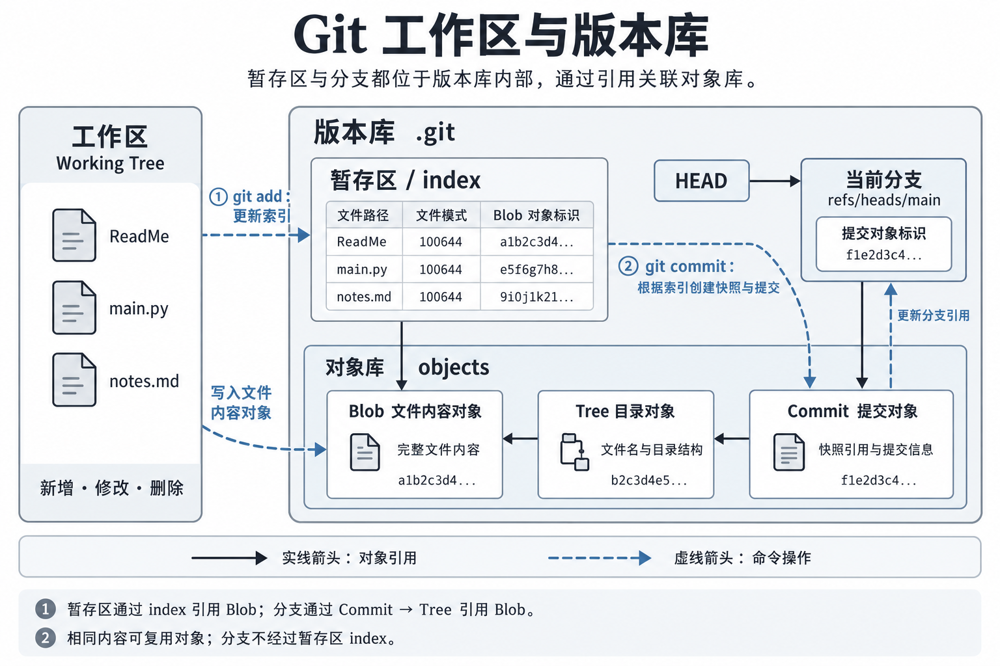

# 03 工作区、暂存区与版本库

## 1. 工作区与版本库的结构

| 区域 | 含义 | 常见位置 |
| --- | --- | --- |
| 工作区（Working Tree） | 实际编辑文件的地方，包含文件的新增、修改和删除 | 项目文件夹中除 `.git` 元数据之外的工作文件 |
| 暂存区（Staging Area / Index） | 记录准备放入下一次提交的文件状态 | 普通仓库中通常由 `.git/index` 保存索引信息 |
| 版本库（Repository） | 保存 Git 对象、提交历史、引用和配置等数据 | 普通仓库中的 `.git` 目录 |

**暂存区和分支都在版本库内部，它们通过对象标识关联到同一个对象库中的 Git 对象。** 工作区、暂存区和版本库不是三个互不包含的文件夹。

普通仓库中的包含关系、对象引用与命令操作：



图中实线箭头表示引用关系，虚线箭头表示命令操作。被引用的 Git 对象统一保存在 `objects/` 中，而不是存放在 `index` 或分支引用文件里面。对象标识为简化示意。

- **暂存区**：索引条目记录文件路径、模式和内容对象标识，通过对象标识找到对应的 Blob 对象。
- **分支**：分支引用记录提交对象标识，先找到 Commit 对象，再通过 Tree 对象找到目录结构和文件内容。
- **对象库**：保存实际的 Git 对象；暂存区和已提交版本可以引用同一个 Blob 对象，无须各自保存一份内容。

这里的 `index` 专指暂存区索引文件。分支通过引用指向提交对象，不经过暂存区的 `index`。

## 2. add 与 commit 如何改变引用

```text
git add：
工作区的文件内容 ──> 对象库中的 Blob 对象
暂存区的文件条目 ──> 对应 Blob 对象的标识

git commit：
根据暂存区 ──> 创建目录快照和提交对象，保存到对象库
当前分支引用 ──> 更新为新提交的标识
```

`git add` 后，文件内容就可能已经进入对象库，但还没有因此形成提交历史。`git commit` 将暂存区记录的文件状态组织成一次可追溯的提交。

对象中的文件内容是对应版本的完整内容，不只是本次增删的几行。版本之间的“修改内容”可以通过比较对象得到。

## 3. 初始化不等于文件已经进入版本历史

例如，项目目录中有：

```text
gitcode/
├── .git/
└── ReadMe
```

`.git` 表明目录已初始化为仓库，但仅凭目录列表无法判断 `ReadMe` 是否已经被跟踪或提交。

如果 `ReadMe` 是初始化后新建、尚未执行 `git add` 的文件，它处于**未跟踪（Untracked）**状态。Git 可以发现它，但尚未将其内容纳入暂存区和提交历史。

```bash
git status
```

`git status` 用于查看文件是否未跟踪、是否有未暂存的修改，以及是否有准备提交的改动。

## 4. git add：记录准备提交的内容

```bash
git add ReadMe
```

对于未跟踪的文件，这条命令将其加入跟踪并暂存；对于已跟踪的文件，则更新暂存区中对应文件的状态。

执行后：

- 工作区中的原文件仍然存在，可以继续编辑。
- Git 将文件内容写入对象库，并更新索引中的对应条目。
- 暂存的是执行 `git add` 时的内容，不会自动包含之后的编辑。

例如：

```text
编辑 ReadMe，内容为 A
        ↓
git add ReadMe       暂存区记录 A
        ↓
继续编辑，内容为 B    工作区为 B，暂存区仍为 A
        ↓
git commit          提交的是 A
```

如果需要提交 B，应在提交前再次执行 `git add ReadMe`。

## 5. git commit：形成版本记录

```bash
git commit -m "添加 ReadMe"
```

提交以暂存区为依据，记录项目的一次快照。即使工作区还有其他未暂存的修改，这些修改也不会自动进入本次提交。

一次普通提交主要包含：

- 指向项目目录快照的树对象引用。
- 父提交引用；首次提交没有父提交。
- 作者、提交者、时间和提交说明等信息。

提交成功后，通常会更新当前分支，使其指向新提交。暂存区不会简单地“清空”，而是保留与本次提交快照对应的文件状态。

## 6. .git 的主要结构

以下是普通仓库中常见的结构，具体文件会随仓库状态和 Git 配置而变化：

```text
.git/
├── HEAD
├── config
├── description
├── hooks/
├── info/
│   └── exclude
├── objects/
├── refs/
│   ├── heads/
│   └── tags/
└── index
```

| 文件或目录 | 作用 |
| --- | --- |
| `HEAD` | 通常指向当前分支；分离 HEAD 状态下直接指向某个提交 |
| `config` | 当前仓库的局部配置，例如局部用户名和邮箱 |
| `index` | 保存暂存区的索引信息，包括文件路径、模式和内容对象标识等 |
| `objects/` | 对象库，保存文件内容、目录结构、提交等 Git 对象 |
| `refs/heads/` | 保存本地分支引用 |
| `refs/tags/` | 保存标签引用 |
| `hooks/` | 存放可在特定 Git 操作前后运行的钩子脚本；`.sample` 文件通常是示例 |
| `info/exclude` | 当前仓库的本地忽略规则，不随普通项目文件提交 |
| `description` | 仓库描述文件，主要供 GitWeb 等工具使用 |

`index` 在刚初始化、尚未暂存文件时可能不存在。分支和标签引用也可能被打包到 `packed-refs`，不一定都以单独文件出现在 `refs/` 中。

这些内部文件通常由 Git 命令维护，日常操作不应直接手动修改。

## 7. HEAD、分支与提交的关系

在当前分支为 `master` 的普通状态下：

```text
HEAD ──> refs/heads/master ──> 当前提交 ──> 项目快照
```

- `HEAD` 表示当前检出的位置，通常通过分支引用间接指向提交。
- 分支名可以是 `master`、`main` 或其他名称，不是固定为 `master`。
- 提交保存在对象库中，分支本身是指向提交的引用，不是存放项目副本的普通目录。
- 刚初始化且没有提交时，`HEAD` 可以指向尚未产生首个提交的分支。

## 8. Git 对象类型与复用

Git 的常见对象类型：

| 对象类型 | 记录内容 |
| --- | --- |
| Blob | 文件内容，本身不保存文件名 |
| Tree | 目录结构、文件名、模式及对象引用 |
| Commit | 项目快照引用、父提交和提交元数据 |
| Tag | 附注标签的信息及其目标对象 |

`git add` 通常已经将文件内容写入 Blob 对象，索引保存对应的文件路径和对象标识。`git commit` 再根据索引生成所需的 Tree 对象和 Commit 对象。

相同内容可以复用已有对象，因此每次操作不一定都会产生一个全新的文件内容对象。Git 在逻辑上记录快照，底层也可以通过对象复用、打包和差量压缩节省存储空间。

## 9. 查看工作区、暂存区与当前提交的差异

```bash
# 查看文件状态
git status

# 比较工作区与暂存区中已跟踪文件的差异
git diff

# 比较暂存区与当前提交的差异，即准备提交的改动
git diff --cached

# 查看提交历史
git log --oneline
```

未跟踪文件的内容默认不会出现在 `git diff` 中，应先通过 `git status` 识别。首次提交前，`git diff --cached` 会显示已暂存、准备作为首次提交内容的文件。

[上一章：用户名、邮箱与配置作用域](02-用户名邮箱与配置作用域.md) · [返回目录](README.md)
